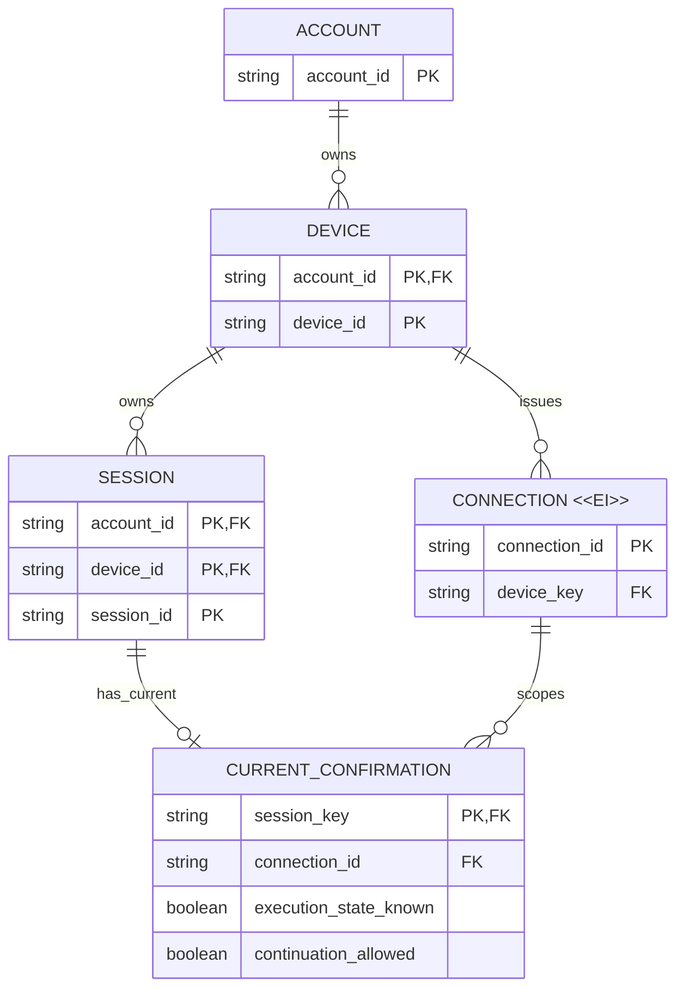
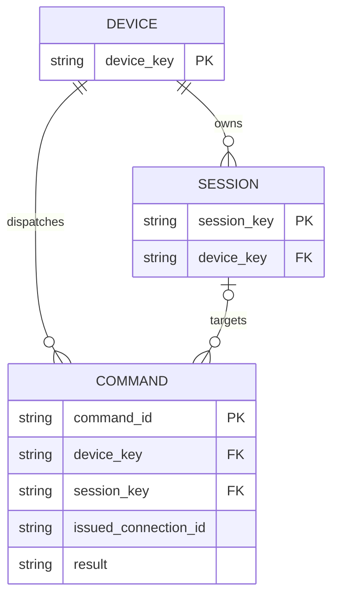

# 业务模型评审：连接确认与执行状态分离

## 需要批准的决定

- 不改变账号、设备或 Session 身份；设备离线只改变可达性投影，历史仍归属原 Session。
- 当前连接的执行状态可信度与可继续能力分别确认，元数据历史会话不伪称 Idle，也不因此永久无法继续。
- 已交付但结果未确认的命令保留未知；可信结果关联原命令，不自动重发。

## 主要变化

| Current | Proposed | Why |
|---|---|---|
| Online 与 Session 快照没有共同确认上下文 | 用当前连接限定 Session 确认；重连立即使旧确认失效 | 上传过或读到快照不等于本次连接已确认 |
| SDK 磁盘元数据映射 Idle；可写判断与状态可信度混用 | 执行状态可未知，能力明确确认后可主动继续；只读仍只读 | 不推断 agent 停止，不阻塞可恢复的历史工作 |
| 重连把所有未完成命令标失败 | 区分未交付失败、真实执行失败和已交付结果未知 | 防止误报和重复执行 |

## 目标业务视图

这是确认归属的概念图，不要求为每个框新增物理表。CURRENT_CONFIRMATION 是 Session 当前确认投影，CONNECTOR_PROCESS 是可丢失的执行环境，不是持久实体。

第二图中的 DEVICE 和 SESSION 与第一图是同一实体；`device_key` 表示账号与设备的复合身份，`session_key` 再包含 Session ID。命令可针对设备（列举/创建）或某条 Session（历史/消息）；原连接归属不会因重连改变。

## 生命周期与不变量

| 实体/投影 | 可变内容、有效期及清理 |
|---|---|
| CONNECTION `<<EI>>` | 身份与设备绑定签发后固定；重连发新身份。关闭、租约失效、撤销终止有效性，操作记录保留必要归属；不要求永久存储连接实体。 |
| CURRENT_CONFIRMATION | 可变投影，每条 Session 至多一份当前确认；旧连接或旧观测不得恢复当前状态/能力，丢失确认不删除 Session。 |
| SESSION | 标题、执行元数据和历史可更新；Offline 不覆盖执行状态，不改变复合身份或删除正文。 |
| COMMAND | 交付和结果更新，身份、目标、原连接归属固定。未知不是成功/执行失败；可信结果可以结束未知，停止 UI 跟踪不改变记录。 |

1. 所有确认和命令都在账号、设备授权范围内；失去访问后不能借离线缓存继续呈现正文或操作。
2. 确认必须属于当前有效连接；活动时间、一次成功 GET、历史上传成功都不能替代它。
3. 执行状态未知与不可继续不同；Offline、尚未确认能力、只读或权限不足仍禁止设备操作，包括已有输入请求操作。
4. 当前快照不得被旧事件覆盖；离线缓存可作为历史补传，不恢复旧执行提示。
5. 交付记录与原连接绑定应在实际交付前完成；结果补传只补传观测事实，不再执行命令。
6. 结果证据若仅在进程内保存，进程重启可能丢失；不能承诺恢复不可得的结果，只能保持明确未知。

## 迁移和兼容

实施需要在现有持久化模型中支持当前连接确认与命令结果归属；原主键和历史身份不变。旧 connector 缺少确认协议时不能默认为已确认，必须提供明确兼容提示。迁移、实际版本发布与设备升级属于 Deployment seed，不是构想验收完成的证据。

具体字段、并发屏障、上游输入请求兼容及结果恢复实现留在 Implementation 阶段；本支持文档不是第二份实施合同。

## 评审材料检查

两个 Mermaid ER 块已用 Mermaid CLI 渲染并逐图检视，`<<EI>>` 标签、基数与关系动词可读且无交叉遮挡；身份与原有账号/设备/Session 复合键交叉核对。图中确认投影不暗示新增表，连接清理也不删除命令的历史归属。这里验证的是构想模型表达，不是迁移或应用功能验收。

**批准问题：是否接受保持原实体身份、连接限定的状态/能力分离确认，以及未知命令结果不自动重发的模型方向？**
