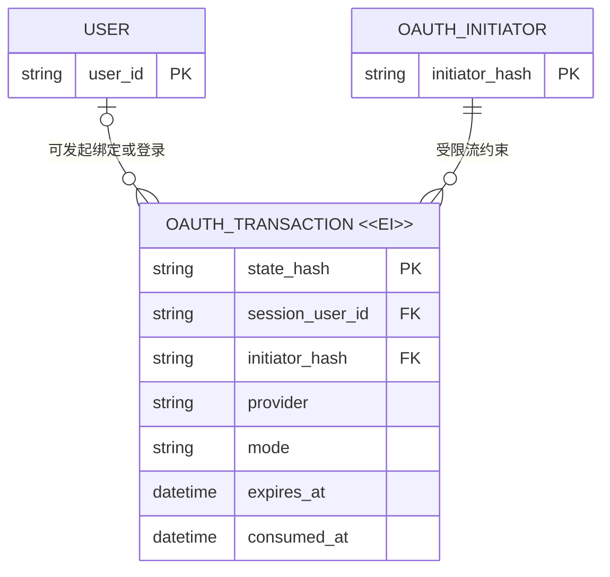

# OAuth 事务过期语义评审

## 请求批准的决定

- 将 OAuth transaction 视为十分钟后自动失效的临时不可变凭据。
- 所有有效性查询必须按解析后的时间值判断，不得依赖时间字符串的字典序。
- 保留现有记录格式和每个发起者最多十条有效事务的限流规则。

## 关键变化

| | 当前 | 提议 | 原因 |
| --- | --- | --- | --- |
| 过期判断 | ISO 8601 `expires_at` 与 SQLite `CURRENT_TIMESTAMP` 直接按文本比较 | 先解析为数据库时间值，再进行比较 | 两种文本格式分别包含 `T` 与空格，同一 UTC 日期内会产生错误排序 |
| 限流计数 | 已过期但未消费的记录可能继续占用名额 | 只统计未消费且真实未过期的记录 | 恢复十分钟有效期的业务含义 |
| 持久化兼容性 | 现有记录保存 ISO 8601 UTC 时间 | 不改写记录或 schema | SQLite 可正确解析现有值，无需迁移 |

## 目标模型

`OAUTH_INITIATOR` 是用户 ID 或公网 IP 经密钥哈希得到的限流身份投影，不是新增持久化实体；图中用于表达 transaction 的限流归属。

## 生命周期语义

| 实体 | 语义 | 可变内容 | 有效性如何结束 | 删除规则 | 重要性 |
| --- | --- | --- | --- | --- | --- |
| OAuth transaction `<<EI>>` | 创建后身份、提供方、模式、上下文和过期时刻固定 | 仅 `consumed_at` 可从空值原子地写入一次 | 成功领取时消费，或创建十分钟后过期 | 可由独立保留策略清理；清理不影响业务身份 | 过期记录不得继续占用发起者的限流名额 |

## 关键不变量

1. `state_hash` 唯一标识一次 OAuth 尝试，回调最多消费一次。
2. transaction 在 `expires_at` 之后无效，无论 `consumed_at` 是否为空。
3. 限流只统计同一发起者未消费且未过期的 transaction。
4. 已登录用户按用户身份归属，匿名用户按 Cloudflare 提供的公网 IP 归属；本次不改变该边界。
5. 登录、绑定和所有 OAuth 提供方共用现有每发起者十条有效 transaction 的上限。

## 迁移与兼容性

现有 `expires_at` 均为 SQLite 可解析的 ISO 8601 UTC 文本。修复仅改变读取时的比较语义，不修改 schema、键、记录内容或历史归属，因此无需数据迁移；回滚代码会重新暴露错误限流，但不会损坏数据。

## 待批准

是否批准按解析后的时间值统一判断 OAuth transaction 有效期，同时保持现有记录格式和十条限流边界不变？
