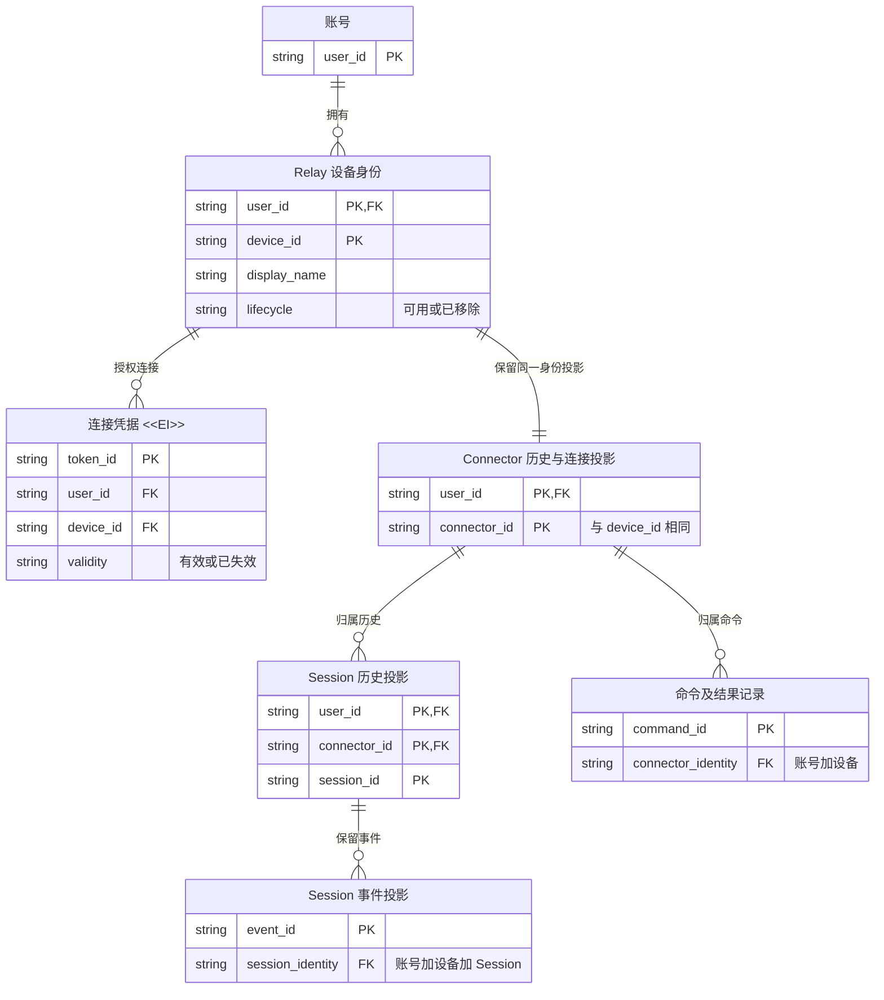

# 设备重命名与移除：业务模型评审

## 待批准的决定

- 设备是账号内稳定的 Relay 身份；名称可变，Session 始终归属原身份。
- 删除是不可恢复连接资格的移除，不是历史或本机数据清除；保留已同步历史，只读访问。
- 重新添加同一台机器产生新身份与新凭据，不自动合并旧 Session。

行为边界由 [Idea.md](Idea.md) 定义；本材料解释其业务影响。

## 关键变化

| Current（源码事实） | Proposed（建议） | Why |
| --- | --- | --- |
| Device 与 Connector 各保存名称，token 元数据读取前者，Devices/Session 界面读取后者；没有改名入口。 | Device 是名称权威，修改后同步 Connector 的显示投影，各处显示当前名称。 | 不改变身份或中断连接，也不产生两个不同名称。 |
| Revoke 仅撤销一个 token，保留设备；连接关闭后客户端仍自动重试。 | 移除覆盖该设备全部 token，关闭连接且使旧连接身份失效；所有写入与重新授权路径拒绝已移除设备。 | 防止遗留凭据、轮换竞态或迟到写入恢复访问。 |
| Session 属于 Connector，物理删除 Connector 级联删除 Session、事件和命令。 | 保留 Device/Connector 的历史身份，不走此级联删除；正常设备列表排除它，历史来源仍可读。 | 移除设备不应意外销毁已同步历史。 |
| token 决定 deviceId，注册只更新已有 Connector。 | 保持此身份机制；旧身份不恢复，重新添加发放新身份。 | 复用现有机制，避免把设备名称或物理机器误当身份键。 |

## 目标模型：谁拥有身份、凭据和历史

这是业务关系图，不是拟定 DDL；Device 与 Connector 当前没有直接外键，图中关系由同账号同 ID 的应用规则维持。

事件实际复合主键含账号、Connector、Session 和 event_id，且同 Session 内 sequence 唯一；图中简写不改变这些现有键。Session ID 不跨设备全局唯一。

## 生命周期与不变量

| 实体 | 可变内容与失效方式 | 删除与保留 |
| --- | --- | --- |
| Device | 可用时可重命名；可用 → 已移除为单向业务转换。 | 首版保留历史身份，无恢复或物理清除入口。 |
| TOKEN `<<EI>>` | 签发后身份、所属账号与设备、密钥绑定不变；使用时间及撤销/替换状态可更新。轮换创建新凭据，过期、撤销或设备移除终止有效性。 | 保留关联及替换记录；移除不要求物理删除。EI 不表示整行不可更新。 |
| Connector | 在线状态、连接身份和能力是可变投影，名称来自 Device。 | 移除后拒绝旧连接继续写入，保留其历史外键根。 |
| Session / Event | Session 是可更新观察投影；事件按 ID/sequence 去重且可补齐内容，**不是 Append Only**。 | 已移除设备下不再接收 Connector 更新，保留已同步部分，不承诺完整本机历史。 |
| Command | 状态随发送和结果推进；已发送但未确认不能冒充未执行。 | 未发送命令明确失败；保留已发送未确认的结果不确定性与已有结果。 |

1. 所有管理操作由账号所有者执行；连接凭据不能管理设备或读取其他账号的历史。
2. 名称不是身份或唯一键；允许重名，改名不迁移 Session，不轮换 token，不重新注册连接。
3. 名称同步必须原子完成。移除的持久化状态、全部凭据失效和写入屏障必须一致，并抵御并发轮换、注册及迟到事件。
4. 凭据有效不只取决于 revoked/expiry，还必须关联可用设备；旧 socket 的异步关闭不是唯一访问屏障。
5. 正常 Devices 清单与历史来源必须可区分；保留但无法发现的历史不满足验收。
6. 重新添加不会恢复旧设备；本机相同 Session 再次同步时可作为新设备下的独立投影出现，首版不跨身份去重。
7. 移除不表示停止本地 agent、删除本机配置或撤回已发送指令；断开结果与访问禁用结果需明确区分。

在线 socket、连接租约和浏览器缓存不是额外的业务身份；复用现有连接身份校验及按 token 定位的断开机制。

## 持久化、迁移与兼容性

- 当前 [设备迁移](../../../../../../apps/worker/migrations/0007_devices_and_token_bindings.sql) 为 token 绑定设备，并禁止删除仍关联任何 token 的 Device；撤销 token 不解除此约束。采用保留身份的移除语义避免拆除该关联。
- 当前 [Session 迁移](../../../../../../apps/worker/migrations/0004_connectors_and_agent_sessions.sql) 的级联规则保持用于其他已有生命周期，设备移除不触发它。旧 daemon、token 替换链与历史记录不在首版清理范围。
- 现有设备默认保持可用，迁移不改 ID、所有权或历史归属；新状态字段及物理实现留到实施阶段确定。
- [鉴权](../../../../../../apps/worker/src/auth.ts)、[连接入口](../../../../../../apps/worker/src/index.ts) 与 [在线处理](../../../../../../apps/worker/src/connector-session.ts) 是已核对机制；现有客户端无需自行提供名称或设备 ID。
- 新增移除语义后，旧服务端不能在回退中重新接受已撤销凭据或旧连接。发布与回滚须验证兼容边界，不能以删掉状态字段作为恢复手段。
- 当前 [前端](../../../../../../apps/web/src/App.tsx) 按 Connector 清单加载 Session；需要保留历史发现路径。增加显示状态而仅过滤整个 Connector 清单不够。

Mermaid 已用 CLI 渲染并目视检查：`<<EI>>` 标签、关系动词、基数与键可读，关系无交叉；已与本轮核对的源码及迁移交叉检查。该验证只针对模型评审图，不证明功能实现完成。

没有待决定的产品分支；尚未选定的数据库字段、API 形状、断开失败重试方式及历史筛选布局属于实施细化，不授权功能实现或部署。

**是否同意“稳定身份可改名、移除后连接资格不可恢复但历史只读保留、重新添加产生新身份”的业务模型？**
