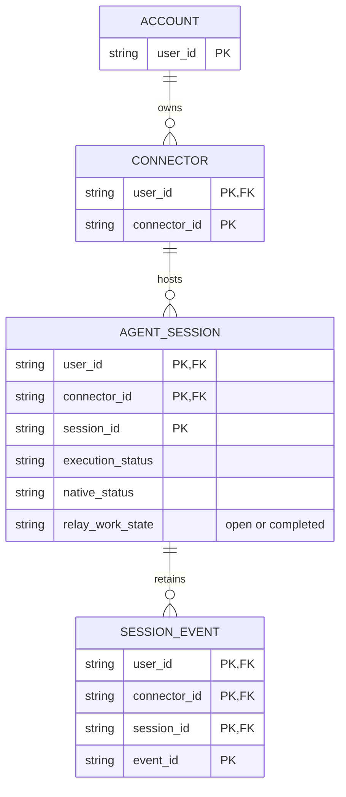

# Session 完成与 Reactivate：业务模型评审

## 待批准的决定

在 Relay 的账户所属 Session 上引入可逆的工作状态 `open / completed`，不将其混入 Agent 的执行或原生归档状态。Reactivate 只把工作状态恢复为 `open`，不会停止、启动或解除 Agent 的原生归档。

## Current / Proposed / Why

| Current | Proposed | Why |
|---|---|---|
| `status` 为 queued/running/waiting/idle/failed/closed/gone/unknown，来自 Connector | 独立的 Relay 工作状态，由所属账户在 Relay 修改 | 用户完成工作不等于 Agent 停止或原生归档 |
| 列表支持 Show ended、Show unavailable 和离线筛选 | 独立的 Show completed；既有筛选仍适用 | 保留执行状态的真实含义 |
| Connector upsert 更新 Session 执行与能力字段 | upsert 保留 Relay 工作状态，只有明确用户操作可修改 | 重连和历史同步不应撤销用户整理结果 |

事实依据：现有 [Session schema](../../../../../../packages/protocol/src/index.ts)、[Session 存储](../../../../../../apps/worker/migrations/0004_connectors_and_agent_sessions.sql)、[Connector upsert](../../../../../../apps/worker/src/connector-session.ts) 和 [列表筛选](../../../../../../apps/web/src/session-list.ts)。路径均指向本仓库；它们是当前事实来源，而非实施承诺。

## 目标业务模型

Connector 在本图代表当前持久化的连接身份，不是正在讨论的独立 Device 模型的替代。Session 的父子关系保持现有语义，本次不增加子会话级联生命周期。

## 生命周期与关键不变量

| 对象 | 可变内容 | 有效性与保留规则 |
|---|---|---|
| Session | Connector 管理执行状态；账户管理 Relay 工作状态 | completed 不终止身份、不删除历史；Reactivate 恢复同一身份 |
| Session event | 现有事件或内容快照可更新 | 维持现有保留策略，不因为完成而删除；因此本图不标记为 AO |

1. Session 唯一身份仍为 `(user_id, connector_id, session_id)`，不能仅按 session_id 操作，避免跨账户或跨 Connector 修改。
2. 工作状态为账户共享的持久状态，不是浏览器偏好；离线操作同样需要服务器确认。
3. 单次变更原子且幂等；重复完成或 Reactivate 不产生命令、复制 Session 或改变消息。
4. Connector 的库存、历史、执行状态和新事件不会覆盖工作状态，也不会自动 Reactivate；并发用户操作以服务器已提交结果为准。
5. Completed 默认不在日常列表；显示已完成项时继续展示真实执行状态。从 Completed 发送新指令前需主动 Reactivate，之后仍执行全部原有发送权限检查。
6. 完成与 Reactivate 只影响目标 Session。父子关系、所有权和已保存内容不变；隐藏父节点时不能丢失仍符合筛选的子节点。

## 迁移与兼容性

- 既有 Session 默认为 `open`，不把 `idle`、`closed` 或未知执行状态自动转换为 Completed。
- 兼容新增 Relay 字段，Connector 不新增完成/Reactivate 命令，旧客户端的 upsert 必须不覆盖该字段。
- 新状态不是数据删除；旧 Web 回滚可以暂时不展示标记，但不能清空已保存状态。
- 独立 Device 模型正在其他 idea 推进；本次保持既有复合 Session 身份，实施时需检查两者的迁移顺序和删除规则，不能让删除 Device 与完成 Session 混为一谈。

## 待确认的范围

用户尚未明确选择 Relay 独立标记或原生归档联动。本候选选择前者；若希望同步 VS Code/Copilot 归档，需要重新准备能力支持、离线命令和执行中处理的不同契约。

## 准备核对

2026-10-12 使用本地 Mermaid 与 Edge 渲染并查看目标图，复合身份、所有权、基数和历史关系与上述源码一致。UI 对比已从本地入口打开，检查 1440px 桌面、390px 窄屏、两个场景、直接打开场景、键盘切换和 iframe 高度收缩，无横向溢出或浏览器错误。此检查仅验证评审材料，不代表产品功能已实施或上线。

是否接受“Relay 工作状态独立于 Agent 执行和归档状态”的模型决定？
