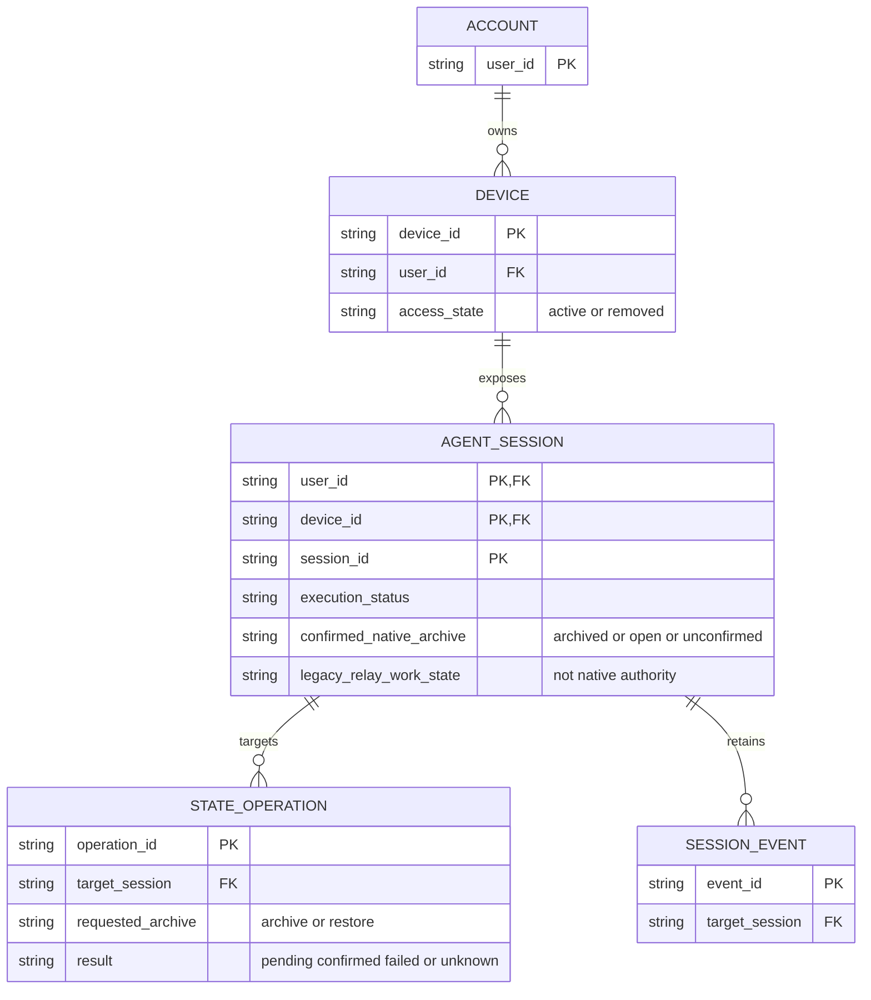

# Session Done / Restore 联动：业务模型评审

## 待批准的决定

- 对确认支持能力的 VS Code Session，从 Relay 发起原生 Done / Restore，并以本机确认的原生归档状态双向同步。
- 离线或未确认能力时禁用；只有确认本机结果才显示成功，超时显示结果未确认，不自动重放。
- 不将既有 Relay 独立标记批量转换为原生归档；保留账户、Session 身份和历史，明确原生副作用。

## Current / Proposed / Why

| Current | Proposed | Why |
|---|---|---|
| Relay `work_state` 与原生 `nativeStatus` 独立，账户 API 仅更新 Relay 标记 | 支持联动的 Session 以本机确认的原生归档状态决定完成/恢复；旧标记只作为旧模式历史 | 手机完成应与本机 VS Code Done 一致 |
| Connector 只有库存、创建、消息及历史命令 | 增加能力声明及目标 Done / Restore 操作的可追踪结果 | 不把接收请求或本地 DB 写入当作本机成功 |
| 普通离线设备也可修改 Relay 标记 | 联动要求在线及能力确认；断线不伪成功或自动重放 | 避免本机没有执行但手机声称完成 |
| Connector 同步不覆盖独立标记 | 本机手动 Done / Restore 同步为原生权威状态 | 双向操作不应再次造成矛盾 |

## 目标业务模型

此图是业务视图，不指定新表。Device 对应当前账户拥有的设备身份，传输仍使用 `connector_id`；Session 完整身份仍为 `(user_id, connector_id, session_id)`。`target_session` 是对完整复合身份的引用，不是仅凭 session_id 的外键。请求目标及归属不变，结果可随确认更新，因此操作记录不标记 AO；Session 事件沿用既有内容快照/保留语义，也不标记 AO。

## 生命周期与关键不变量

| 对象 | 权威及可变内容 | 有效性与保留规则 |
|---|---|---|
| Device | 账户控制访问；Connector 当前连接提供能力 | 已移除设备不可借 Restore 恢复访问；旧连接结果不能改变新连接的确认 |
| Session | VS Code 管理原生归档；Agent 管理执行状态；Relay 保存确认投影与旧标记 | 完成不替换 Session 身份；取消归档不等于具备发送能力 |
| State operation | 账户请求目标状态，本机确认决定结果 | 目标及账户固定；pending 可成为 confirmed、failed 或 unknown，不因传输重连自动重放 |
| Session event | 现有历史与内容快照 | 不因 Relay 完成而删除；原生平台副作用不由 Relay 伪造保证 |

1. 凭当前账户、设备和 Session 的完整身份授权，且在当前连接核对目标能力；“可以发消息”不等于“可以 Done/Restore”，归档 Session 即使不能发送也可具有恢复能力。
2. 操作下发、原生动作确认和 Relay 状态投影不是跨网络原子事务。接收请求不算成功；只有匹配目标和期望状态的本机确认才显示成功。拒绝不更新为期望状态，超时保持未确认。
3. 本机手动改变归档状态同步到 Relay，执行状态和普通新消息不能伪造完成/恢复；状态较旧、来源连接过期的结果不得覆盖新确认。
4. VS Code Session/default chat 使用 Session 级归档，独立子 chat 需使用 chat 级动作；不向整个父 Session 错误发送子 chat 的操作。原生父归档可能影响子项只读，这不是 Relay 额外批量操作。
5. 列表与详情使用同一动作和结果。Show completed 应直接提供已完成历史与 Restore 入口，不能要求再启用 Show ended 才能找到原生归档项；其他搜索、设备、离线筛选及发送权限保持有效。
6. 既有 Relay completed 不代表原生归档。升级不遍历旧标记下发命令；支持联动的 Session 接到新鲜本机状态后采用原生结果。未确认/不支持项明确提示旧标记不代表 Done，禁用新联动。

## 可行性证据及原生副作用

已安装的 `@microsoft/agent-host-protocol` 提供 client-dispatchable `SessionIsArchivedChanged` 和 `ChatIsArchivedChanged`，后者说明默认 chat 应用 Session 级动作。当前 [VS Code provider](../../../../../../packages/connector/src/vscode-agent-host-provider.ts) 已有 Agent Host 连接、Session/chat 绑定和消息动作确认，但没有归档写入方法；[provider 接口](../../../../../../packages/connector/src/agent-host-provider.ts) 和 [Relay 协议](../../../../../../packages/protocol/src/index.ts) 也没有对应能力/命令。当前 [API](../../../../../../apps/worker/src/api.ts) 只写 Relay work_state。因此当前线上不联动是实际实现边界，不是手机请求遗漏。

官方源码固定于 `c480e9e49e2a116c458518ecbdec56d50e4af3d2`：

- [Done / Restore 动作](https://github.com/microsoft/vscode/blob/c480e9e49e2a116c458518ecbdec56d50e4af3d2/src/vs/workbench/contrib/chat/browser/agentSessions/agentSessionsActions.ts)：Done/Restore 共享 archive/unarchive 行为，调用 setArchived(true/false)。
- [Agent Host 列表写入](https://github.com/microsoft/vscode/blob/c480e9e49e2a116c458518ecbdec56d50e4af3d2/src/vs/workbench/contrib/chat/browser/agentSessions/agentHost/agentHostSessionListStore.ts)：Session 归档使用 `SessionIsArchivedChanged`。
- [Session flags 持久化](https://github.com/microsoft/vscode/blob/c480e9e49e2a116c458518ecbdec56d50e4af3d2/src/vs/platform/agentHost/node/chatContributions/sessionFlags/sessionFlagsContribution.ts)：未拒绝的动作写入原生归档标记，恢复清除自动归档时间。
- [附加 worktree 生命周期](https://github.com/microsoft/vscode/blob/c480e9e49e2a116c458518ecbdec56d50e4af3d2/src/vs/platform/agentHost/node/chatContributions/additionalWorktreeLifecycle/additionalWorktreeLifecycleContribution.ts)：Session 归档变化调用原生 cleanup/recreate 逻辑；不是所有安装版本都一定具备同样副作用。

协议层可行不等于已完成本机集成验证。必须在实施时核对实际连接版本、能力、Session/chat 映射、确认与外部操作结果；本次调查没有读取账户凭据或修改任何真实 Session。

## 迁移与兼容性

- 旧 Connector 不声明能力，新联动禁用并提示升级；SDK-only 或不支持的 Session 不伪装具备原生 Done/Restore。
- 保留旧 Relay 工作标记与历史，不批量调用原生 API；新鲜本机确认可能使以前 Relay-only completed 而本机仍 open 的项重新显示，应解释这是采用原生权威，不是自动 Restore。
- 需要更新 Connector/协议和能力协商。确切 schema 与兼容策略在实现阶段确定，不在此猜测新迁移；部署需记录最低支持版本与升级步骤，npm 发布另走已有授权流程。
- 原生归档可能标记已读、清理/重建附加 worktree或影响子 chat；Relay 不另外清理文件、不主动停止 Agent，不承诺取消归档能撤销全部原生副作用。回滚不能自动取消已经确认的 Done。

## 准备核对

2026-10-12 本地 Edge / Playwright 已渲染 Mermaid 并视觉核对实体、复合 Session 身份、账户/设备关系、操作与历史的基数和关系动词；它是目标业务视图，不声称新字段或新命令已实现。当前代码与固定 revision 的官方源码核对支持上述可行性结论。两个 UI 场景已验证 1440px、390px、320px、直接打开、键盘场景切换、启用/禁用状态、44px 点击区、tooltip、静态点击、iframe 高度和无横向溢出，并视觉核对桌面与手机。此为评审材料验证，不是产品或本机联动验证。

是否接受“VS Code 原生 Done / Restore 双向权威、在线能力门控和确认后成功”的模型决定？
