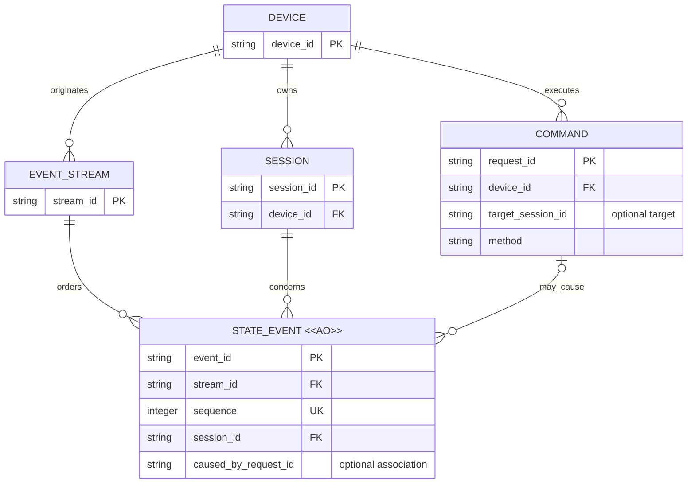

# 信道职责分离的业务模型评审

## 待讨论决定

- 用户已提出：Session 状态事实单向传播且历史不可变；用户操作通过命令 RPC 发起。
- 用户已明确：中继只承担可淘汰缓存角色，按整个 Session 淘汰，不裁掉 Session 内旧历史；未命中时依赖设备回源。
- 用户已明确：历史为通常 Agent Session JSONL 的记录粒度，不包含流式中间状态，不要求回放逐 token 或逐 chunk 更新。
- 用户已明确三个逻辑信道的名称：Session 状态信道、命令信道、可订阅消息信道。第三信道承载临时实时消息，由第二信道控制订阅与取消订阅；仅记后续 TODO，本期不实现。
- 本评审提出候选：历史 event、领域对象当前投影、命令关联分别建模，不互相替代。
- 尚未决定：设备/provider 的可回放历史保证、事件流粒度、排序来源和命令去重生命周期。本文不是构想验收请求。

## Current / Proposed / Why

| Current：当前源码 | Proposed：候选目标 | Why：业务理由 |
| --- | --- | --- |
| worker 事件冲突可更新原行 | 已发布 event 只追加，变化以新 event 表达 | 重放与多层缓存不会读到同身份的不同事实 |
| sequence 同时用于展示顺序、读取游标，provider 由时间生成 | 逻辑流身份与稳定位置明确，时间仅是事实属性 | 历史与实时统一，恢复不依赖墙钟或重建猜测 |
| 可选 turn/part 字段用于 Web 快照折叠 | event 身份与被描述对象身份分开 | 内容可持续变化而历史不可变 |
| 用户消息通过命令发送，消息历史由设备回传 | 保留该职责分离，补齐明确的接纳、未知结果及事实关联 | 前端意图不被误认作 Agent 已收到或任务已完成 |

事实依据：[现状清单](./Current-WebSocket-Primitives.md)。具体候选原语与示例见 [理想信道草案](./Ideal-Channel-Primitives.md)。

## 目标模型：谁拥有历史，命令如何关联事实

图表达逻辑身份与归属，不决定物理表。sequence 只在 stream 内唯一，session ID 需在来源命名空间内解释；图中的 PK 不宣称 provider 原生 ID 跨设备全局唯一。

流粒度尚未决定，因此不把 Session 与 stream 画为一对一。Session 发现与设备目录同步另需定义覆盖范围；图不表示一次清单缺项即删除 Session。

COMMAND 是操作关联概念，不承诺它是持久实体；是否持久保存请求、去重记录或结果仍待决定。caused_by_request_id 是可选逻辑关联，不要求先收到命令记录才能接收状态事实。

缓存、快照及 UI projection 为派生物，不是新的历史权威实体；后续第三类临时实时消息不进入图中的 STATE_EVENT 或历史游标，订阅生命周期本期不建模。执行状态由事实投影，人工工作状态未在本轮建立模型。

## 生命周期语义

| 概念 | 允许变化 | 有效性或保留结束 | 删除与影响 |
| --- | --- | --- | --- |
| STATE_EVENT，AO | JSONL 级历史事实只追加；不含流式中间状态；更正使用后续补偿事实，不改原 event | 中继副本可以按 Session 整体淘汰；设备侧保留保证待定 | 不允许为节省缓存只清理 Session 的旧事件；设备原始历史清理另行定义，不可变不等于无限保留 |
| SESSION | 元数据、执行与生命周期状态可由新事实推进 | 关闭不等于清除历史 | 删除、归档及敏感内容清理政策待定 |
| EVENT_STREAM | 已发布位置绑定不变；流可继续追加 | 来源切换、流结束与新流关系待定 | 不通过重置序号冒充旧流的连续延伸 |
| COMMAND | 执行观察可从未确认推进到明确结果 | 超时只结束等待，不证明执行失败 | 去重与结果保留期限待定；相同请求身份不得绑定不同参数 |

## 关键不变量

1. 设备侧是领域事实的生产边界；中继和前端可以转发、缓存、投影，不独立杜撰 Agent 已收到或执行完成的事实。provider 与 Connector 谁负责规范化历史仍待决定。
2. eventId 标识历史事实，message/part 等 ID 标识被观察对象，requestId 标识操作意图，三者不能互换。
3. 同 stream 的 eventId 和 sequence 绑定稳定；重复事实幂等，身份冲突显式失败，不更新旧事实。
4. 只从连续归约的位置推进恢复游标；缺失范围必须补齐或明确声明 gap，不能把最大已见序号当成完整历史。
5. 快照包含基准与覆盖范围，不能凭当前状态伪造原始历史；历史读取与实时消费必须使用一致归约语义。
6. 命令接纳、Agent 执行终态与人工任务完成是三个不同事实；命令 result 与相关 event 可以交错到达。
7. 中继历史缓存的淘汰单位为 Session，不能保留尾部并声称完整；淘汰不改变设备 Session 生命周期或命令结果记录的有效性。局部加载必须声明覆盖范围，设备不可用时不能返回成功形状的空历史。

历史完整性仅要求覆盖约定的 JSONL 级记录；不因缺少流式中间更新而视为历史缺失。provider 的历史补传和实时发布需要识别同一份历史记录，而不是保存全部原始实时帧。

## 迁移与兼容影响

当前只新增评审文档，无代码、DDL、schema、版本或数据迁移。目标模型与当前可变 upsert 行为存在实质差异，不能把现有库行直接标注为不可变原始日志。

如后续获准实现，需要先定义旧事件投影如何导入、历史覆盖范围如何声明，以及旧客户端恢复游标的兼容边界。当前存储包含部分中间快照，不能简单沿用其数量或序号来宣称符合目标历史粒度。不能凭最终 part 内容重新制造实时更新历史；不能未经决定自动迁移或清空现有消息。

## 当前聚焦问题

本期继续收敛 JSONL 级历史记录的语义、稳定身份与核心 RPC 命令；临时实时消息、订阅及取消订阅的时序另列后续 TODO，不作为当前模型实施要求。具体 wire 契约尚未请求验收。
