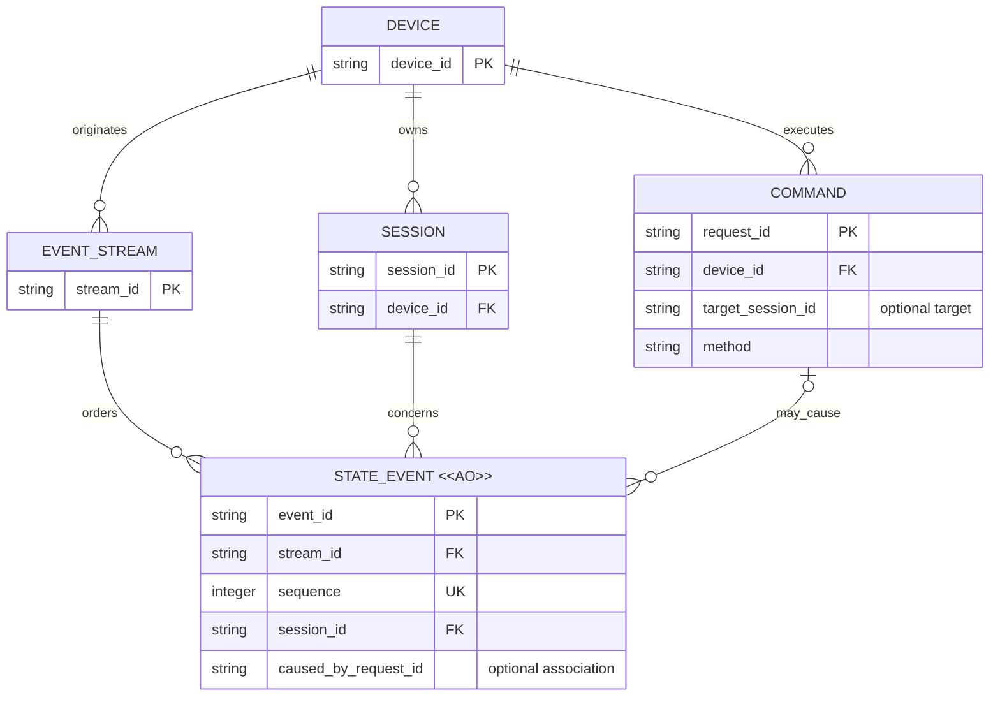

# 两信道与统一观察的业务模型评审

## 待批准决定

- 两个方向信道取代三类业务信道：下行发请求，上行发反馈；带观察基准的 long poll 统一补历史与等待更新，不建立长期订阅实体。
- 历史事实、当前观察与临时更新区分身份和保留保证；JSONL 级历史不可变，中继按整个 Session 淘汰历史缓存，未命中显式回源或报告不可用。
- Connector 可短时主动续推；接收方可丢弃，读取恢复不依赖续推。请求关联不代替内容身份，临时缓冲过期必须显式报告。

## Current / Proposed / Why

| Current：当前源码 | Proposed：候选目标 | Why：业务理由 |
| --- | --- | --- |
| worker 事件冲突可更新原行 | 已发布 event 只追加，变化以新 event 表达 | 重放与多层缓存不会读到同身份的不同事实 |
| sequence 同时用于展示顺序、读取游标，provider 由时间生成 | 逻辑流身份与稳定位置明确，时间仅是事实属性 | 历史与实时统一，恢复不依赖墙钟或重建猜测 |
| 可选 turn/part 字段用于 Web 快照折叠 | event 身份与被描述对象身份分开 | 内容可持续变化而历史不可变 |
| 用户消息通过命令发送，消息历史由设备回传 | 保留该职责分离，补齐明确的接纳、未知结果及事实关联 | 前端意图不被误认作 Agent 已收到或任务已完成 |
| 历史上传、当前观察与 commands subscription 各有实现入口 | 两个方向承载统一读取、操作响应和更新通知，读取不创建 Agent 工作 | 历史补齐与观察更新共用原语，不新增持久订阅所有权 |
| 实时 part 可按对象投影更新 | 历史身份不变，临时更新使用独立版本与短期保留 | 去重不抹掉新预览，短期丢失不伪装成完整历史 |

事实依据：[现状清单](./Current-WebSocket-Primitives.md)。具体候选原语与示例见 [理想信道草案](./Ideal-Channel-Primitives.md)。

## 目标模型：谁拥有历史，命令如何关联事实

图表达逻辑身份与归属，不决定物理表。sequence 只在 stream 内唯一，session ID 需在来源命名空间内解释；图中的 PK 不宣称 provider 原生 ID 跨设备全局唯一。

流粒度尚未决定，因此不把 Session 与 stream 画为一对一。Session 发现与设备目录同步另需定义覆盖范围；图不表示一次清单缺项即删除 Session。

COMMAND 是操作关联概念，不承诺它是持久实体；是否持久保存请求、去重记录或结果仍待决定。caused_by_request_id 是可选逻辑关联，不要求先收到命令记录才能接收状态事实。

缓存、快照及 UI projection 为派生物，不是新的历史权威实体；临时实时消息不进入图中的 STATE_EVENT 或历史游标。long poll 请求、观察基准及续推窗口是运行期同步概念，不新增持久订阅实体，因此不加入此历史 ER 图。COMMAND 仅表示可产生领域事实的操作，不把读取请求画成事实的生产者。人工工作状态未在本轮建立模型。

## 生命周期语义

| 概念 | 允许变化 | 有效性或保留结束 | 删除与影响 |
| --- | --- | --- | --- |
| STATE_EVENT，AO | JSONL 级历史事实只追加；不含流式中间状态；更正使用后续补偿事实，不改原 event | 中继副本可以按 Session 整体淘汰；设备侧保留保证待定 | 不允许为节省缓存只清理 Session 的旧事件；设备原始历史清理另行定义，不可变不等于无限保留 |
| SESSION | 元数据、执行与生命周期状态可由新事实推进 | 关闭不等于清除历史 | 删除、归档及敏感内容清理政策待定 |
| EVENT_STREAM | 已发布位置绑定不变；流可继续追加 | 来源切换、流结束与新流关系待定 | 不通过重置序号冒充旧流的连续延伸 |
| COMMAND | 执行观察可从未确认推进到明确结果 | 超时只结束等待，不证明执行失败 | 去重与结果保留期限待定；相同请求身份不得绑定不同参数 |
| 读取请求与续推窗口，运行期 | 请求绑定目标、范围与观察基准；窗口内可发送更新通知，不反复完成同一 RPC | 请求最长等待及续推空闲/总时限有界，连接失效不能继续确认旧来源状态 | 不再续拉即停止观察，剩余通知可丢弃；不终止 Agent，也不删除历史 |
| 临时更新，运行期 | 每个通知身份/版本绑定固定内容，新预览使用新版本，不更新旧历史 | 短期缓冲可过期，保留期与合并策略待定 | 超出可恢复范围明确缺口；可以恢复当前状态，不承诺重放全部 token |

## 关键不变量

1. 设备侧是领域事实的生产边界；中继和前端可以转发、缓存、投影，不独立杜撰 Agent 已收到或执行完成的事实。provider 与 Connector 谁负责规范化历史仍待决定。
2. eventId 标识历史事实，message/part 等 ID 标识被观察对象，requestId 标识一次读取或操作调用；临时更新另有版本，不能互换。不同 requestId 重传同一事实不产生新历史。
3. 同 stream 的 eventId 和 sequence 绑定稳定；重复事实幂等，身份冲突显式失败，不更新旧事实。
4. 只从连续归约的位置推进恢复游标；缺失范围必须补齐或明确声明 gap，不能把最大已见序号当成完整历史。
5. 快照包含基准与覆盖范围，不能凭当前状态伪造原始历史；同一历史记录经读取或续推到达使用一致归约语义。续推丢弃不推进基准，关闭续推仍可恢复；临时缓冲过期则显式缺口，旧预览不能覆盖已确认历史或更新观察。
6. 命令接纳、Agent 执行终态与人工任务完成是三个不同事实；命令 result 与相关 event 可以交错到达。
7. 中继历史缓存的淘汰单位为 Session，不能保留尾部并声称完整；淘汰不改变设备 Session 生命周期或命令结果记录的有效性。局部加载必须声明覆盖范围，设备不可用时不能返回成功形状的空历史。

历史完整性仅要求覆盖约定的 JSONL 级记录；不因缺少流式中间更新而视为历史缺失。provider 的历史补传和实时发布需要识别同一份历史记录，而不是保存全部原始实时帧。

## 迁移与兼容影响

当前只更新评审文档，无代码、DDL、schema、版本或数据迁移。目标模型与当前可变 upsert 行为存在实质差异，不能把现有库行直接标注为不可变原始日志。

如后续获准实现，需要先定义旧事件投影如何导入、历史覆盖范围如何声明，以及旧客户端恢复游标的兼容边界。当前存储包含部分中间快照，不能简单沿用其数量或序号来宣称符合目标历史粒度。不能凭最终 part 内容重新制造实时更新历史；不能未经决定自动迁移或清空现有消息。

不能把当前 tRPC subscription 直接宣称为新的统一读取模型；读取响应与续推通知需有可识别的关联，旧客户端未处理续推不能破坏读取。上线前验证续推关闭的兼容路径，不能以“幂等”代替缺口恢复或参数冲突检查。

核对基线：`cd018f2e791f005aae284bcd651f9296ebb53e94`。已核对 [领域 schema](../../../../../../packages/protocol/src/index.ts)、[RPC 输入及操作](../../../../../../packages/rpc/src/index.ts) 和 [worker 存储](../../../../../../apps/worker/src/connector-session.ts) 的身份、连接观察序号及事件冲突更新；图中的稳定流、追加历史是目标语义，不声称现有 upsert 已满足。Mermaid 已本地渲染并检查 AO 标记、基数与关系动词；运行期同步概念不新增持久表或迁移。

## 未决事项

设备/provider 的可回放历史保证、流粒度、排序来源、复合观察基准与命令去重生命周期仍待细化；临时缓冲保留期、缺口恢复与续推时限/额度不在此处猜定。

是否接受“两个方向信道、统一读取与有界可选续推，历史与临时观察保持独立身份和保留保证”的模型方向？
