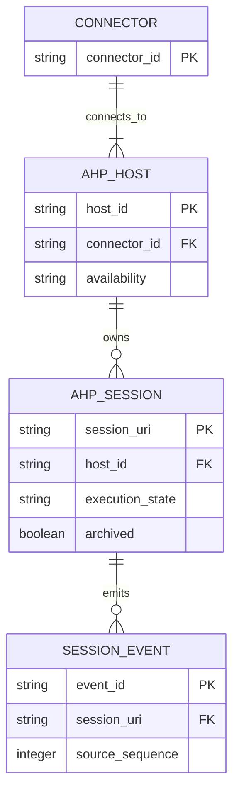

# AHP 单一 Session 身份业务数据模型评审

## 请求批准的决定

- Connector 只接受 AHP Host 拥有的 Session URI 作为对 Relay 暴露的业务身份。
- list、create、send、history、status、event 与 archive 必须沿同一 AHP 控制面执行。
- Copilot SDK ID 不再进入新 Relay 数据；旧行保留但不自动关联、迁移或删除。

## Material changes

| Current | Proposed | Why |
| --- | --- | --- |
| SDK 与 AHP 都向 Relay 产生 Session | 只有 AHP Session 进入 Connector inventory | 消除并行 namespace 与重复行 |
| 操作按 ID 是否存在动态选择 SDK 或 AHP | 所有操作固定路由到拥有该 AHP Session 的 Host | 防止同一用户意图作用于不同底层 Session |
| Agent Host 不可用时可回落到 SDK ID | 显式 offline/error，保留原 AHP 身份 | fallback 不能在没有映射时切换身份 |
| 历史 SDK 行继续随 inventory 更新 | 旧 Relay 行仅按现状保留 | 避免高风险回填与删除 |

## Target model

`AHP_SESSION.session_uri` 是 Connector 与 Relay 的唯一新 Session 身份。Agent backend 可以在 Agent Host 内部使用 Copilot、ACP 或其他实现，但其私有 ID 不进入此模型。

## Lifecycle semantics

| Entity | 可变内容 | 终止或删除 | 评审意义 |
| --- | --- | --- | --- |
| `AHP_HOST` | availability、连接 generation 与能力 | endpoint 消失时变为不可用；重连不改变既有 Session URI | 不可用必须显式呈现，不能切换 SDK namespace |
| `AHP_SESSION` | title、status、activity、chat、archive 与能力 | 由 AHP Host 生命周期与归档语义决定 | Host 是身份和状态权威 |
| `SESSION_EVENT` | 遵循现有来源序列与幂等写入语义 | 本方向不改变现有保留策略 | Relay 不重写 AHP 事件身份与顺序 |

## Key invariants

1. 新 Relay Session ID 只能由一个规范化 AHP Session URI 派生，并在其生命周期内保持稳定。
2. 同一 Connector 不得把 SDK `sessionId` 与 AHP URI 同时发布为可见 Session。
3. create、send、history、status、event 与 archive 必须路由到拥有目标 URI 的同一个 AHP Host。
4. Host 不可用或目标 URI 不存在时必须返回明确错误或离线状态，不得恢复或创建同名 SDK Session。
5. 多个本地或远程 Host 的路由身份必须参与内部唯一性，避免不同 Host 上相同 URI 冲突。
6. 旧 Relay 行和事件保持原主键与内容；缺少来源标记时不得猜测其 SDK/AHP 归属。

## Migration and compatibility

- 移除 Connector 的 Copilot SDK inventory、create、resume、send、history 与 event fallback，并删除运行时依赖。
- AHP provider 补齐当前尚未接入的 create 与完整 adapter 能力；backend 选择留在 Agent Host 内部。
- 部署后只新增或更新 AHP 行。旧 SDK 行继续存在于 D1，不执行配对、重写、删除或 URL 重定向。
- 回滚恢复旧 Connector 版本即可；回滚不需要反向数据迁移，但可能再次产生 SDK 投影。

## Open decisions

- 多 Host 场景下 Relay ID 使用完整规范 URI，还是使用稳定 host routing identity 与 URI 的组合。
- 旧的未确认 SDK 行是否在后续独立 idea 中默认隐藏、标记 legacy 或按保留策略清理。
- AHP createSession 的 provider/config 选择如何暴露给 Relay 创建命令。

**批准问题：是否接受“AHP Host 拥有唯一 Session 身份与全部操作控制面，Copilot SDK 不再由 Connector 直接使用”的目标模型？**
