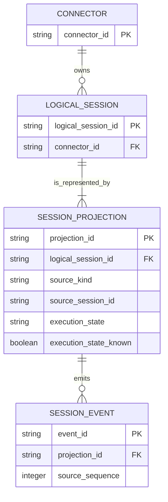

# Session 跨来源身份业务数据模型评审

## 请求批准的决定

- 将“用户理解的一个逻辑 Session”与“SDK 或 Agent Host 暴露的来源投影”区分建模。
- 只有稳定、可证明的来源关联才能让多个投影归属同一逻辑 Session；无证明的投影保持独立。
- 关联不删除来源记录或事件，实时投影只在确认有效时提供展示状态和交互能力。

## Material changes

| Current | Proposed | Why |
| --- | --- | --- |
| Relay Session 身份等同于 connector 返回的来源 ID | 逻辑 Session 拥有一个或多个明确归属的来源投影 | 两个协议可为同一会话提供不同 ID |
| 相同 ID 才能由实时投影覆盖持久化投影 | 通过稳定关联键决定投影归属，再按当前有效性选择展示投影 | 避免重复行，同时不依赖时间或文本猜测 |
| 事件只通过来源 Session ID 归属 | 事件继续保留来源投影归属，并由逻辑 Session 聚合展示 | 保留审计、历史完整性与协议差异 |

## Target model

`LOGICAL_SESSION` 是用户可导航和展示的身份；`SESSION_PROJECTION` 是 SDK 或 Agent Host 对该身份的来源特定观察。图中没有把 projection cache、连接 observation 或命令 receipt 建模为业务实体，它们仍是运行时一致性机制。

## Lifecycle semantics

| Entity | 可变内容 | 终止或删除 | 评审意义 |
| --- | --- | --- | --- |
| `LOGICAL_SESSION` | work state、展示投影选择；来源归属仅能随可证明关联变化 | 随现有保留策略结束；本方向不授权删除 | 保持稳定导航身份，避免来源重连制造新逻辑会话 |
| `SESSION_PROJECTION` | 来源报告的 title、状态、能力与确认新鲜度 | 来源消失可失效，但不因此删除历史 | 实时状态与持久化恢复能力可以来自不同投影 |
| `SESSION_EVENT` | 遵循现有事件 upsert/补历史语义 | 本方向不改变现有保留策略 | 关联不能抹去来源、顺序或协议差异 |

## Key invariants

1. 一个来源投影在同一 connector 内由 `(source_kind, source_session_id)` 唯一识别，并且同时只归属一个逻辑 Session。
2. 没有稳定关联证据的来源投影必须创建或保留独立逻辑 Session；标题、时间邻近和消息内容不能单独改变身份。
3. 一个逻辑 Session 至少保留一个来源投影；解除或更改关联时不得孤立事件。
4. 展示状态只能来自当前连接确认有效且声明状态已知的投影；否则明确呈现状态不可用。
5. resume、send 与 history 路由到支持该能力的来源投影，不能因展示折叠而丢失 SDK fallback。
6. 历史事件始终保留来源投影归属；聚合展示不重写 event ID、sequence 或 role。
7. 若关联关系持久化，投影归属与逻辑 Session 创建必须原子提交并可审计。

## Migration and compatibility

- 优先验证 connector 能否以协议提供的稳定字段生成关联；不先对现有 200 行执行启发式回填。
- 若需要 Relay 持久化，采用新增逻辑身份/投影映射的兼容读路径；已存在的 `(user_id, connector_id, id)` 和 URL 在过渡期继续可解析。
- 只 backfill 可由稳定证据证明的关系，原事件行保持原位。回滚应关闭聚合展示，而不是拆写或删除历史数据。
- 数据清理、来源行合并和 URL 重定向均不包含在本次方向批准内，需独立迁移证据。

## Open decisions

- Copilot SDK 与 Agent Host 是否能通过现有 context、project、`_meta` 或未来协议字段提供同一稳定关联 ID。
- 逻辑身份应由 connector 在同步前生成，还是由 Relay 持久化来源映射。
- 旧来源 URL 指向逻辑 Session 时采用 alias、redirect 还是兼容查询。

**批准问题：是否接受“逻辑 Session 与来源投影分离、仅凭稳定证据关联、历史与 fallback 不删除”的目标业务模型？**
