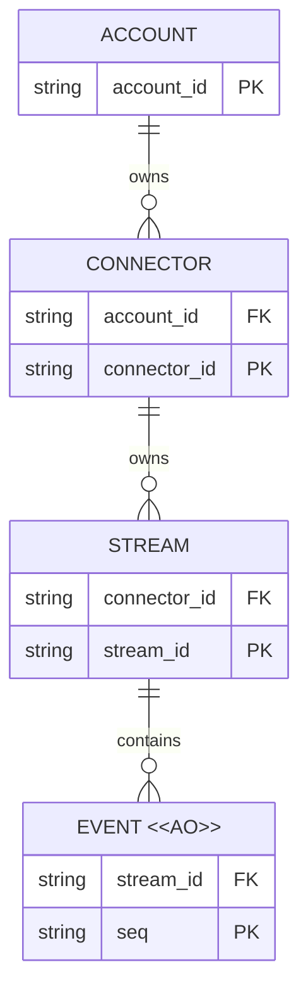

# 通用事件同步业务模型评审

## 待批准决定

- 同步域采用 Connector、Stream、Event 三层，复用现有账户和设备身份。
- 事件正常操作仅追加，不覆盖历史；连接、凭证和订阅不决定历史身份。
- 旧 Session 模型保留，Supervisor 业务模型与新 UI 留待后续。

## Current / Proposed / Why

| Current | Proposed | Why |
| --- | --- | --- |
| Connector 绑定设备，现有传输和模型主要描述 Session | Connector 是稳定逻辑接入身份，当前复用设备 ID，拥有多条通用流 | 无需为每种业务重做同步或增加重复设备实体 |
| Session 事件冲突时可以更新内容 | Stream 中的 Event 以流内序号唯一标识，只能追加 | 补传可幂等，历史变化可追溯，不静默覆盖 |
| DO 路由以 token ID 为依据 | 同步内容归属稳定账户/设备，token 仅授权访问 | 凭证轮换、连接和进程重启不改变日志身份 |

当前依据：[设备身份](../../../../../../apps/worker/migrations/0007_devices_and_token_bindings.sql)、[旧事件写入](../../../../../../apps/worker/src/connector-session.ts)、[连接路由](../../../../../../apps/worker/src/index.ts)。具体协议见主体世界的[技术方案](../Event-Stream-Sync-Design.md)。

## 目标 ER 视图

图中 Connector 是逻辑身份，当前与已有设备一一对应，不另建平行设备注册体系。键表示业务范围，不指定物理表。

## 生命周期与关键不变量

| 对象 | 可变性与结束条件 |
| --- | --- |
| Connector | 名称、凭证与在线状态可变，稳定身份不随网络连接或凭证变化；沿用设备移除和账户访问规则 |
| Stream | 归属和流身份固定，提交位置仅连续推进；进程重启不重置序号。无法延续原日志时显式使用新身份 |
| Event `<<AO>>` | 正常操作仅追加；同位置同内容重试不新增，不同内容拒绝。保留策略可以单独清理旧历史，读取方必须获知缺口，不承诺永久保留 |

1. 完整事件身份为账户、Connector、Stream 和序号的组合；图中的局部键不能作为跨账户访问凭证。
2. 一批事件与流头必须原子提交，持久保存之后才确认；原子性不包含业务投影。
3. 每条流单写、流内有序，不提供跨流全局顺序或多写者合并。
4. Connection 是临时会话；Subscription 是读取状态；Token 是访问凭证。三者不是同步内容层级，轮换或重连不重新归属历史。
5. 设备移除与凭证撤销阻止后续未授权访问，不隐含物理清理所有历史；保留和访问规则分别处理。
6. Session、Objective 和 Supervisor 由业务事件和投影表达，底座不新增远程目标下发、执行或授权语义。

## 迁移与兼容

- 增量加入新的同步协议与 DO 日志，保留旧 Session 数据和接口，不将可变 Session 记录直接冒充不可变原始历史。
- 生产端没有可靠日志时，适配层先持久化；缺失历史必须报告，不从当前快照补造旧事件。
- DO 是物理分片而非第四级领域实体，首版按稳定账户/设备划分；具体 DDL、租约和资源限制由实施细化。
- 早期 Supervisor 专属模型保留在[背景文档](Supervisor-Model-Background.md)，不作为本轮验收。

是否同意以稳定 Connector 拥有 Stream、Stream 包含不可变 Event，且保留旧 Session 兼容的模型作为本轮同步底座边界？
