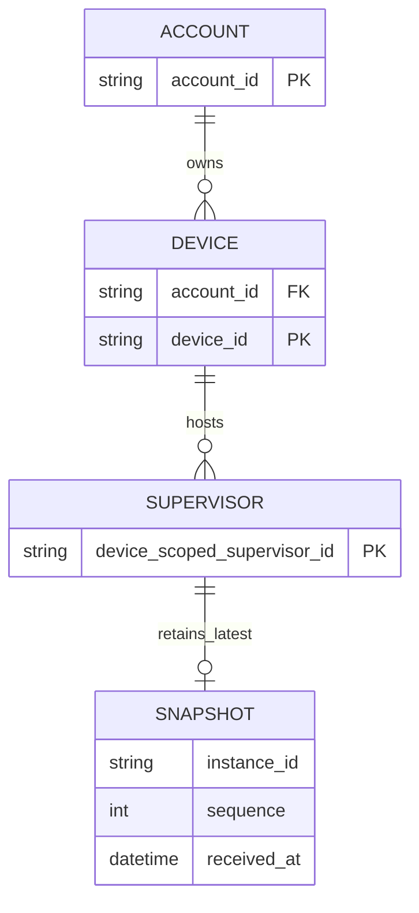

# Supervisor 观测业务模型背景

本文件保留最初讨论的产品方向，不属于本轮通用同步底座的验收或批准范围。当前模型见[同步业务模型评审](Business-Data-Model-Review.md)。

## 待批准决定

- 在现有账户与设备下增加独立的 Supervisor 观测对象，不伪装成 Agent Session。
- 保存最后已知快照，区分稳定身份、运行实例与观察时间；中心持有观测副本，不拥有目标或执行权。

## Current / Proposed / Why

| Current | Proposed | Why |
|---|---|---|
| 账户拥有设备；连接凭据绑定设备，Session 按账户、Connector、Session ID 识别 | 复用既有账户/设备边界，设备拥有零到多个 Supervisor 观测身份 | 复用接入与部署，不改变 AHP Session 业务语义 |
| Session 有独立清单、活动和命令流程 | Supervisor 独立保存最新快照；目标、需求、运行和资源作为其内部投影 | 当前状态不能由聊天记录或旧调度队列推断 |
| 现有在线状态描述 Connector 连接 | 单独表达 Supervisor 上报新鲜度及目标观察时间 | Connector 在线不代表 Supervisor 正常，也不代表目标最近被观察 |

当前依据：[设备及凭据迁移](../../../../../../apps/worker/migrations/0007_devices_and_token_bindings.sql)、[Session 模型](../../../../../../apps/worker/migrations/0004_connectors_and_agent_sessions.sql)、[设备移除行为](../../../../../../apps/worker/src/devices.ts)。现有设备移除为逻辑移除并尝试断开连接，不假定它自动物理删除全部历史。

## 目标 ER 视图

本图表达业务归属与保留语义，不指定物理表或字段全集。设备被管理的目标对象不一定是运行 Supervisor 的设备。

## 生命周期与关键不变量

| 对象 | 生命周期及保留语义 |
|---|---|
| Supervisor | 以账户、设备、设备内稳定 ID 共同识别；进程重启不创造新的业务身份。首次有效快照之前可展示未同步；设备移除后不可继续访问或上报 |
| Snapshot | 可替换的最新观测，不是 Append Only 事件账本。进程实例变化后采用新顺序域，并拒绝旧连接覆盖；离线或中心重启不立即丢弃最后已知快照 |
| 目标、需求、运行、资源 | 当前快照内的只读投影，使用来源关联 ID；不是中心管理的目标配置或新的执行资源 |

1. 所有读取和接入均绑定账户与设备授权，不能仅凭 Supervisor ID 查询跨账户数据。
2. Connector 在线、Supervisor 快照新鲜、目标观察有效是三个不同事实；保留本地观察时间与中心接收时间。
3. 本地 Supervisor 是事实来源；中心不可用不阻塞本地调度，上报失败不得被报告为本地执行失败。
4. 仅接受显式版本和允许字段；不默认复制完整 subject、Agent binding、凭据、提示词或对话。来源尚未暴露的等待原因显示未知。
5. 不新增目标下发、priority 覆盖、执行或授权实体。只读接入不沿用 Session 命令权限。
6. 逻辑移除设备、凭据撤销与数据保留分别处理；移除后不继续展示其投影。快照与有限事件的物理清理上限在实施时明确，不承诺永久历史。

## 迁移、兼容与未决事项

- 新模型应增量加入，不转换 Session ID、迁移 Session 为 Supervisor 或更改现有账户归属。旧 Connector 不支持观测时不伪报已同步，也不影响其 Session 功能。
- 具体传输 DTO、实例接管校验、过期阈值、载荷与历史保留上限在实施阶段核实；这里不预先批准数据库 DDL。
- potential-guide 当前提供 Planner/Coordinator 的内部观察入口，但缺少完整、可直接远程展示的统一事实投影。真实接入依赖其适配器交付，不能以 UI 夹具宣称完成。

是否同意在上述身份、隔离、保留与只读边界下增加 Supervisor 观测模型？
