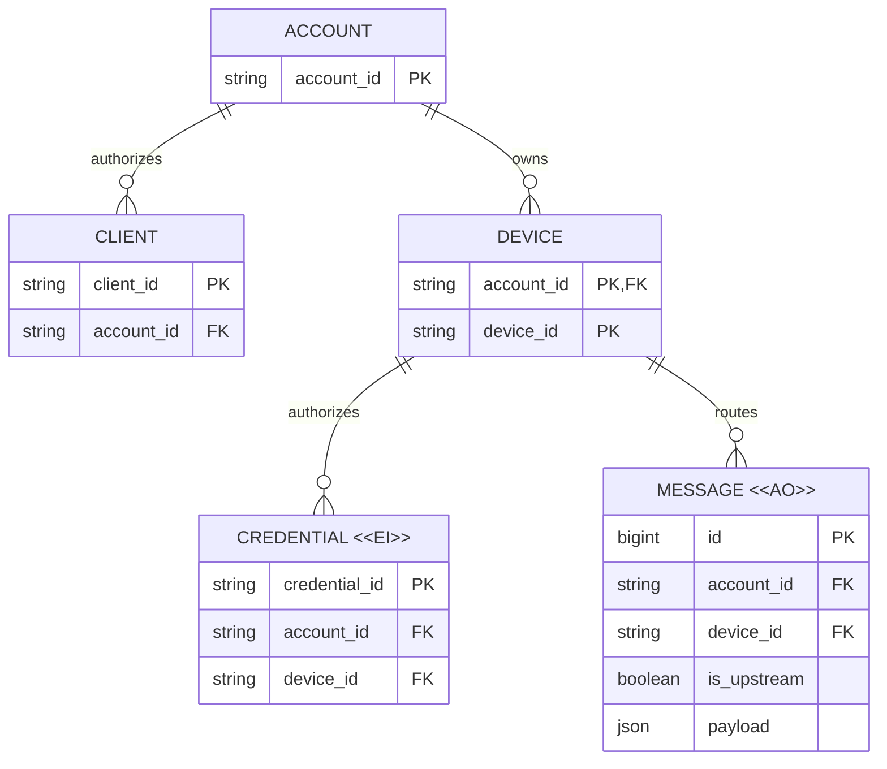

# Account、Device 与 Client 双向业务模型评审

## 请求决定

1. 以 Account 为中心，统一称 Device（下游设备端）与 Client（上游用户客户端），两端为多对多关系；将 Device→Client 单向消息升级为双向：Client 每条 regulation 指定一个 Device，每个 Device 每条 event 群发给同 Account 所有 Client。
2. Device 是唯一的下游业务身份，消息、历史和固定两个方向均归属 Device；Connector 是供设备端宿主嵌入的通信 lib，不是额外业务实体，不拥有另一套业务 ID、流或历史。库升级、宿主重启、重连和凭证轮换不更换 Device。保留设备自治、消息追加不可改写与各方向独立确认，不再开放用户创建多 Stream。
3. Message 自增 ID 兼作排序与补读依据，不额外引入 position。模型提案简化为一张双向 Message，方向用 `is_upstream` 布尔值，移出非核心的 producer/task 字段；保留版本隔离和原历史只读定位，精确存储与切换方案后续细化。

## Current / Proposed / Why

| Current（已核实源代码） | Proposed（目标模型） | Why |
| --- | --- | --- |
| 现有消息从 Device 上行到 Client；浏览器只读，v1 按 account/device 路由并显式订阅设备内 stream | Account 拥有多个 Device 并授权多个 Client；每条下行只到指定 Device，上行到该 Account 全部 Client，每个 Device 固定两个方向 | 多对多业务通信不等于下行群发；上行群发不依赖 Client 逐设备选择订阅 |
| 同一 device 有单活动 writer lease/generation，浏览器只读订阅 | 单活动 Device 实例消费下行及上报；多个 Client 可并发定向提交，且各自独立接收所有 Device 的 events | 下游单一责任主体不等于上游只有一个写者；一个 Client 的进度不能代替其他 Client |
| token 绑定 device，历史设备 ID 可能来自旧 connector 或 `token-` 前缀 | Device 归属于 Account，消息、凭证与历史归属 Device；Connector 只提供连接程序实现 | 不为程序引入第二个业务身份；重连、重启、轮换或替换程序不能使 Device 身份或历史消失 |
| v1 事件为各 stream 的 seq/payload；上一版目标图还包含直连关系、position、producer_id 和 task_ref | Client/Device 仅通过 Account 关联；Message 采用自增 ID、Account、Device、方向与 payload | 避免把可推导关系、重复排序字段和上层业务关联固化进消息路由模型 |

源依据与差异详见[连接与消息设计](Connection-and-Message-Design.md#现状证据与差异)。以下为业务实体，不是拟建表清单。

## 目标 ER：谁拥有身份，谁拥有消息？

Device 是持久的下游设备端业务身份，以 Account/Device 定位，不是每次进程启动，也不要求某种特定执行框架。每个 Device 固定承载 regulation 下行与 event 上行两个方向；它们是消息属性与交付职责，不是用户可创建的额外业务实体。图中 `routes` 包含下行以 Device 为目标、上行以 Device 为来源。Connector 仅是运行在设备端的连接程序，因此不进入业务 ER 图；连接、租约、游标与物理日志分区也不提升为独立业务身份。

Client 是代表用户操作的上游客户端，可以是浏览器或其他获授权应用；一个 Account 可有多个 Client 和多个 Device，多对多通信能力通过共同 Account 推导，不再绘制冗余的 Client–Device 直连关系或维护配对表，也不代表每条下行发给多个 Device。所有仍具有效账户访问权的 Client 都是该 Account 上行群发接收方，不要求逐 Device 订阅。

图中 Client 是业务端点视图，`client_id` 为身份提案；消息生产者归属须认证并可追溯，不因此要求新增 Client 资产表。Client 身份不等于某次订阅/连接。Device 的 Account 归属须与消息、凭证一致；凭证/连接不得另设一套可替代 Device 的业务身份。

Message 的 `id` 由 Relay 的权威消息存储自增分配，不由多个 Client 共用本地计数器；同一消息表内唯一、持久、不复用，直接承担排序和补读游标，不再另设 position。`is_upstream=true` 为 Device→Client，false 为 Client→Device；`device_id` 分别表示来源或目标。双向先用同一张 Message 表，不因逻辑两方向立即拆表。

`producer_id` 不是路由必填字段，鉴权来源与需要的审计/重试归属可记录在服务端元数据中；`task_ref` 等任务关联属于可选 payload 内容，Relay 不要求解析。客户端提交前的稳定幂等键是请求/同步协议元数据，不是尚未分配的 Message ID。详见[自增 ID 与恢复规则](Connection-and-Message-Design.md#最小消息模型与自增-id)；这些可靠性要求不意味着把字段重新加回业务 ER 图。

## 生命周期与关键不变量

| 实体 | 可变内容与有效性终止 | 删除/修正与理由 |
| --- | --- | --- |
| Device | 展示信息与授权状态可变；Account 归属与 Device 身份不因 Connector 程序更换、重连/重启或凭证轮换变化 | 停用不等于删历史；有权删除与保留策略单独执行，禁止静默复用旧身份 |
| Client | 连接和独立消费进度可变；账户访问过期/撤销则停止交付 | 断线不确认消息；历史补读受账户权限及保留期约束，不要求为永不返回的 Client 无限保留 |
| Credential `<<EI>>` | 签发后身份、作用域和绑定固定，轮换签发替代凭证；过期/撤销终止访问 | 可按审计保留规则清理；撤销状态是有效性记录，不是把旧凭证改绑新主体 |
| Message `<<AO>>` | 正常业务只追加；接收、执行、完成、取消通过关联的新消息表达 | 不改写原 regulation 或事件；允许专门授权的保留期清理/删除，必须暴露历史缺口并保留必要归属与去重证据 |
| 交付/恢复进度（运行状态） | 各 Device 下行与各 Client 上行独立保存已处理 Message ID，保留下界与进度可变 | 不是 Message 的可变状态或额外业务流；ID 可有空洞，缺号不能直接认定丢失/过期 |

1. Account 是路由与授权边界。Client 每条 regulation 必须指定同 Account 的一个 Device；目标缺失、不存在、停用或跨账户时明确拒绝，不回退到默认 Device，不隐式群发。每条 Device event 群发给该 Account 所有有效 Client，不只发给任务发起者或当前浏览 Device 的 Client；跨账户禁止交付。
2. 消息、自增 ID 与请求幂等键对应关系须原子持久化后才确认并通知。相同幂等键和内容/归属重试返回原 Message ID，更改内容或改投其他 Device 明确拒绝。按 ID 补读须保证提交可见顺序安全，不能越过未提交的小 ID 后漏读；ID 不承诺连续，清理后不复用。
3. 同一 Device 只有一个有效活动实例的所有权 generation；接管、租约与写入/消费进度更新须协调，旧 generation 不得追加或推进。多个 Connector 进程竞争同一 Device 身份不是多个业务 Device；fencing 不能撤回已发生的外部副作用。
4. 订阅传输 ACK 不代表业务接收或执行；下行持久接收进度、执行记录与各 Client 账户级接收游标独立。一个 Client 的 ACK 不确认其他 Client，也不推进 Device 执行状态；断线 Client 在保留范围内可补读，超期明确报错，不能静默漏发。
5. 各授权读取范围内按 Message ID 升序读取，两个方向独立消费、至少一次交付。ID 表达存储顺序，不代表现实发生顺序、任务因果或执行完成顺序，不承诺端到端 exactly-once；群发复用同一 Message ID，不按 Client 复制业务消息。
6. Device 身份、历史及本地 outbox/inbox 和游标不能随 Connector 程序升级/替换、重连/重启或凭证轮换而丢失；本地状态丢失必须显式恢复，不能以原身份重置序号并重放未知副作用。同机需要多个独立业务端点时显式登记多个 Device；仅多开连接程序不自动登记新 Device。

## 迁移影响与未决项

- 建议新协议独立命名空间/协商版本，与 v1 并存。保留原 `(accountId, deviceId, streamId, seq)` 定位及授权，原日志通过只读入口/映射读取，不按内容猜任务、不重新编号混合历史。
- 保留既有 Account/Device 身份是迁移默认方向，不创建新 Connector 业务 ID 或 Connector→Device 绑定。现有 `devices`、旧 `connectors`/daemon binding 与 `token-*` 来源须逐项核实，旧表名只是历史实现证据，不是目标领域实体；不能因去掉模型中的 Connector 就删除旧表/改键、丢弃映射或把 token ID 当新的身份来源。凭证轮换不重建 Device，歧义应阻断，不自动合并。
- 不自动将任意旧 stream 转为新 event 流，更不能转成可执行 regulation。需要显式导入时保留来源引用与去重边界，另审导入/切换策略。
- 新 Account 群发入口按账户过滤统一 Message 并用自增 ID 补读，覆盖所有既有/新增 Device；不再要求 Client 汇总各 Device position 或维护复合游标。旧 v1 seq 仍按原来源定位，不为迁就新自增 ID 重新编号合并。
- 新版本接收后，回退旧客户端不能抹掉新消息；保留新历史读取/恢复路径。旧接口何时退出、账户删除/设备移除/凭证撤销对历史的精确影响、保留期限与补偿流程在实施前明确。
- 本轮采用通用 lib＋宿主嵌入＋薄验证 CLI，目标宿主不是新的领域实体；不改变现有 Streams UI、旧 `/legacy` 页面或账户/设备/token 设置。若目标落地需要 UI 改变，必须先做独立的适用 UI 评审，不以“协议调整”隐藏交互变化。

## 评审材料检查

2026-10-20 使用已有缓存 Mermaid CLI 12.0.0 与本机 Chromium 重新渲染简化后的 ER 图，检查 Account 分别关联 Client/Device、消息/凭证归属 Device、自增 ID/布尔方向、`<<AO>>`/`<<EI>>` 字面显示、关系动词与连线；图中不再包含 Client–Device 直连或独立 position/producer/task 字段。与路由不变量及源代码差异交叉核对，文档相对链接目标存在。本记录仅证明设计材料检查，不代表运行、迁移或部署验证。

是否认可上述“通过 Account 关联 Client/Device、下行定向/上行群发、Message 自增 ID 兼作排序与补读、布尔方向与统一消息表”的简化模型及迁移边界，同时将精确协议与切换方案保留为后续待决？
