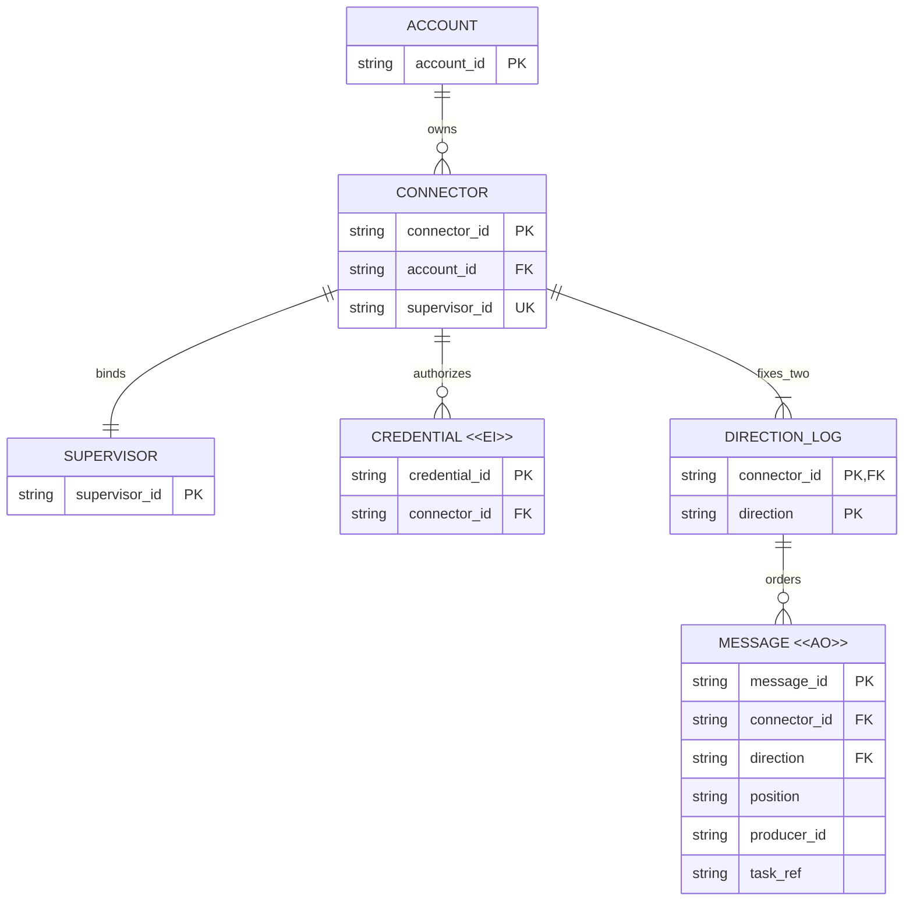

# Connector 双向业务模型评审

## 请求决定

1. 认可一个持久 Connector 对应一个 Supervisor，固定两条方向性消息流，不再开放用户创建多 Stream；同机多个 Supervisor 使用多个独立 Connector。
2. 认可业务身份独立于连接与凭证、消息追加不可改写、各方向独立确认，以及设备自治和可恢复历史的边界。
3. 认可先版本隔离、旧历史只读可定位的迁移方向；不在此批准精确字段、物理 schema、传输技术或切换方案。

## Current / Proposed / Why

| Current（已核实源代码） | Proposed（目标模型） | Why |
| --- | --- | --- |
| v1 以 account/device 路由到 DeviceSync，设备内有多 stream；写者按 stream 自带序号追加 | 账户拥有持久 Connector，每个 Connector 固定 regulation/event 两个方向 | 按业务责任而非日志文件组织传输；任务不再制造传输实体 |
| 同一 device 有单活动 writer lease/generation，浏览器只读订阅 | 单活动 Supervisor 拥有下行消费/执行权及上行上报权；多个获授权客户端可并发提交 regulation 和独立订阅 events | 下游单一责任主体不等于上游只有一个写者 |
| token 绑定 device，历史设备 ID 可能来自旧 connector 或 `token-` 前缀 | Connector ID、Supervisor 绑定与消息归属持久，凭证和连接仅授予暂时访问权 | 重连、重启、轮换不能使身份或历史消失 |

源依据与差异详见[连接与消息设计](Connection-and-Message-Design.md#现状证据与差异)。以下为业务实体，不是拟建表清单。

## 目标 ER：谁拥有身份，谁拥有消息？

图中 `fixes_two` 的精确业务基数是恰好两条，ER 的一到多符号只表达下界；唯一方向值为 regulation 与 event。Supervisor 是责任身份，不是每次进程启动，也不是新增云端设备资产管理表。物理设备不是新的持久传输层级，同机关系无需影响本图。

`message_id` 表示全局唯一消息身份的提案，不是客户端本地序号；Relay 需按 Connector/方向验证归属并为每个方向分配独立 position。精确字段和全局 ID 格式待协议细化。`task_ref` 代表 task/objective/regulation 等业务关联字段族，不在此强加一个统一任务实体；事件可无任务关联，也可通过引用关联 regulation。客户端订阅和连接会话属于运行记录，不是用户可创建的持久业务流。

## 生命周期与关键不变量

| 实体 | 可变内容与有效性终止 | 删除/修正与理由 |
| --- | --- | --- |
| Connector / Supervisor | 展示信息与授权状态可变；绑定身份不因连接/凭证轮换变化，重新绑定须显式另议 | 停用不等于删历史；有权删除与保留策略单独执行，禁止静默复用旧身份 |
| Credential `<<EI>>` | 签发后身份、作用域和绑定固定，轮换签发替代凭证；过期/撤销终止访问 | 可按审计保留规则清理；撤销状态是有效性记录，不是把旧凭证改绑新主体 |
| Message `<<AO>>` | 正常业务只追加；接收、执行、完成、取消通过关联的新消息表达 | 不改写原 regulation 或事件；允许专门授权的保留期清理/删除，必须暴露历史缺口并保留必要归属与去重证据 |
| Direction log | 身份固定于 Connector 和方向；水位、保留下界与消费进度可变 | 不是连接临时资源；清理历史不能伪造从未存在过的连续记录 |

1. 账户是授权边界；上游客户端写 regulation、读 events，下游绑定 Supervisor 消费 regulation、写 events。一个 Connector 不容纳多个 Supervisor；历史读取另受账户与保留授权控制。
2. 每个方向的消息、幂等身份/内容指纹与位置分配须原子持久化后才确认并通知。不同上游不共用本地序号；重复身份且同内容返回原接收结果，异内容拒绝。
3. 每个 Connector 只有一个有效下游所有权 generation；接管、租约与写入/消费进度更新须协调，旧 generation 不得追加或推进。Relay fencing 不能撤回已发生的外部副作用。
4. 订阅传输 ACK 不代表业务接收或执行；下行持久接收进度、执行记录与上游各订阅游标独立，任一浏览器 ACK 不得推进 Supervisor 执行状态。
5. 两方向独立有序、至少一次交付；没有两向全局总序或端到端 exactly-once。任务因果关系依赖显式关联与业务状态，不靠追加先后猜测。
6. Connector 重连/重启/凭证轮换保留身份、outbox/inbox 和游标；本地状态丢失必须显式恢复，不能以原身份重置序号并重放未知副作用。

## 迁移影响与未决项

- 建议新协议独立命名空间/协商版本，与 v1 并存。保留原 `(accountId, deviceId, streamId, seq)` 定位及授权，原日志通过只读入口/映射读取，不按内容猜任务、不重新编号混合历史。
- 旧 device ID 与新 Connector ID 是否直接沿用必须逐项核实：旧 connector、daemon binding 与 `token-*` 来源不同，不能把 token ID 当新的持久身份来源。凭证轮换不重建映射；映射歧义应阻断，不自动合并。
- 不自动将任意旧 stream 转为新 event 流，更不能转成可执行 regulation。需要显式导入时保留来源引用与去重边界，另审导入/切换策略。
- 新版本接收后，回退旧客户端不能抹掉新消息；保留新历史读取/恢复路径。旧接口何时退出、账户删除/设备移除/凭证撤销对历史的精确影响、保留期限与补偿流程在实施前明确。
- 本轮不改变现有 Streams UI、旧 `/legacy` 页面或账户/设备/token 设置。若目标落地需要 UI 改变，必须先做独立的适用 UI 评审，不以“协议调整”隐藏交互变化。

## 评审材料检查

2026-10-20 使用已有缓存 Mermaid CLI 12.0.0 与本机 Chromium 实际渲染本文唯一 ER 图，并检查了实体标签、`<<AO>>`/`<<EI>>` 字面显示、关系动词、基数与连线；图中文字完整、连线无交叉。关系与上述不变量及源代码差异已交叉核对，文档相对链接目标存在。本记录仅证明设计材料检查，不代表运行、迁移或部署验证。

是否认可上述“单 Connector / 单 Supervisor、固定两方向、身份持久与历史可归属”的业务模型及迁移边界，同时将精确协议与切换方案保留为后续待决？
